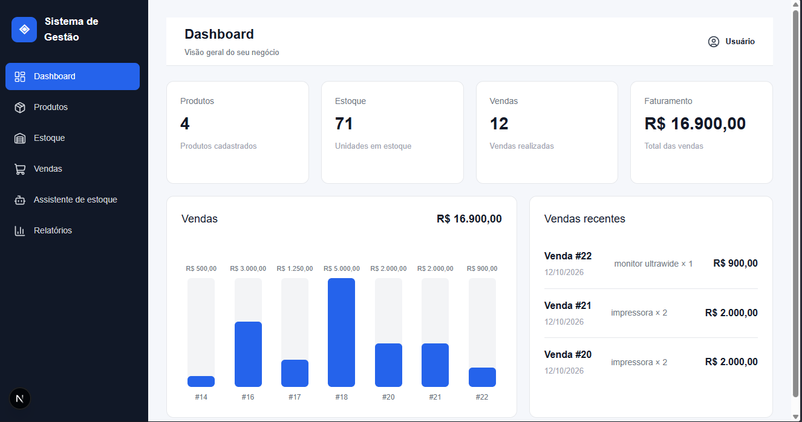
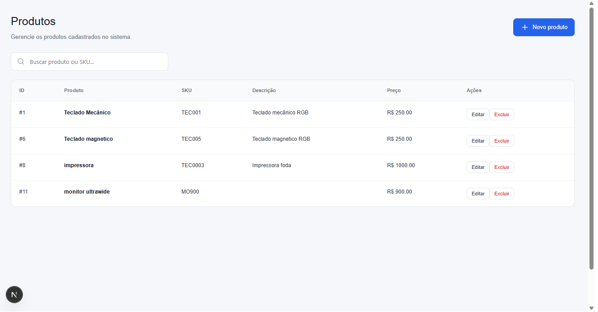
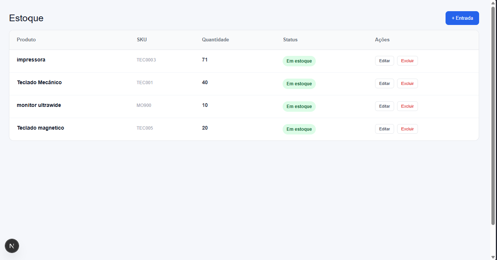
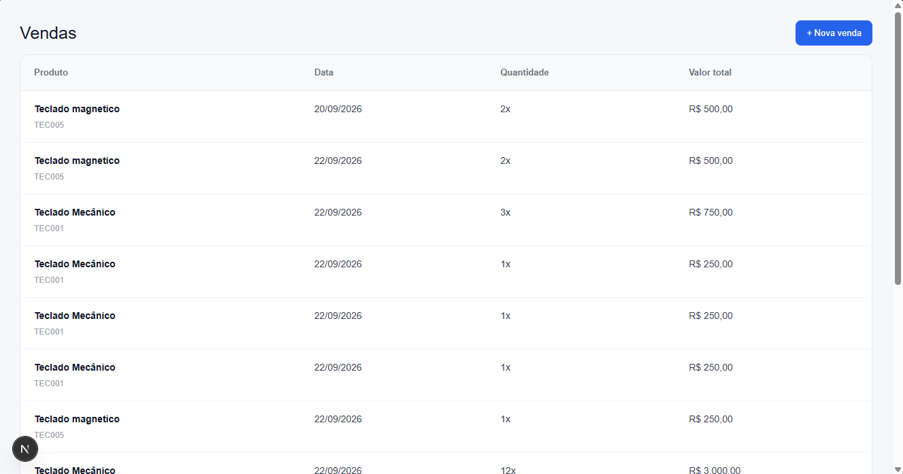
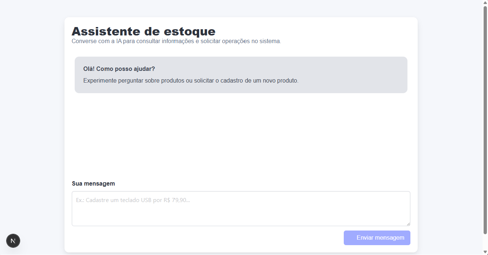

# Gestão de Produtos, Estoque e Vendas com IA

Aplicação web para gerenciamento de produtos, controle de estoque e registro de vendas, desenvolvida com uma arquitetura que separa Front-end e Back-end.

O projeto utiliza **Next.js, TypeScript, Java, Spring Boot, Spring AI e PostgreSQL**, combinando operações tradicionais de gerenciamento com uma interface de conversação por inteligência artificial.

Mais do que um projeto de aprendizagem, esta aplicação representa um marco importante na minha trajetória profissional: um sistema desenvolvido para colocar em prática conhecimentos de programação e que atualmente também está sendo utilizado em um cenário real.

> **Projeto de aprendizagem em uso real:** os dados apresentados para demonstração e documentação são fictícios. A utilização prática da aplicação representa uma oportunidade de aplicar, validar e aprimorar os conhecimentos adquiridos durante o desenvolvimento.

## Screenshots

Esta seção será utilizada para apresentar as principais telas e funcionalidades da aplicação.

### Dashboard

<!-- Adicionar imagem do dashboard aqui -->



### Gerenciamento de produtos

<!-- Adicionar imagem da listagem ou cadastro de produtos aqui -->



### Controle de estoque

<!-- Adicionar imagem da tela de estoque aqui -->



### Gerenciamento de vendas

<!-- Adicionar imagem da tela de vendas aqui -->



### Assistente de inteligência artificial

<!-- Adicionar imagem do chat com IA realizando uma operação aqui -->



*Observação: as imagens acima são espaços reservados. Adicione as capturas de tela reais do projeto nos caminhos indicados.*

## Funcionalidades

### Dashboard

- Visualização geral das informações da aplicação.
- Indicadores de quantidade de produtos e itens em estoque.
- Informações relacionadas às vendas e ao faturamento.
- Gráfico de vendas.
- Listagem de vendas recentes.
- Atualização dos dados apresentados no painel.

### Produtos

- Cadastro de produtos.
- Listagem e pesquisa de produtos.
- Edição e exclusão de produtos.
- Gerenciamento de nome, SKU, descrição e preço.
- Integração com as ferramentas de inteligência artificial para cadastro de produtos por meio do chat.

### Estoque

- Registro de entradas de estoque.
- Consulta das quantidades disponíveis.
- Associação entre produtos e seus respectivos estoques.
- Edição e exclusão de registros de estoque.
- Identificação de produtos com estoque baixo ou indisponível, conforme as funcionalidades implementadas na interface.
- Integração com a IA para adicionar quantidades e consultar o estoque de produtos.

### Vendas

- Registro de vendas com um ou mais produtos.
- Definição da quantidade de cada item.
- Cálculo automático dos subtotais.
- Cálculo do valor total da venda com base nos preços cadastrados.
- Consulta dos detalhes das vendas.
- Exibição dos produtos vendidos, incluindo nome e SKU.
- Atualização do estoque após o registro de uma venda.
- Validação para impedir vendas com quantidade superior ao estoque disponível.
- Integração com a IA para registrar vendas por meio de comandos em linguagem natural.

### Inteligência artificial

- Integração do Spring AI com a API Spring Boot.
- Interface de conversação para interagir com o sistema usando linguagem natural.
- Ferramentas de IA para executar operações de cadastro de produtos.
- Consulta e movimentação de estoque por meio do assistente.
- Registro de vendas por meio de ferramentas integradas aos serviços existentes.
- Utilização das regras de negócio da aplicação para executar as operações.
- Respostas baseadas nos resultados retornados pelas ferramentas e pelos serviços.

A proposta é tornar o gerenciamento mais acessível, permitindo que o usuário realize determinadas operações por meio de comandos em linguagem natural, além das telas tradicionais do sistema.

## Tecnologias utilizadas

### Front-end

- Next.js
- React
- TypeScript
- CSS
- Fetch API

### Back-end

- Java
- Spring Boot
- Spring Data JPA
- Spring AI
- Jakarta Validation
- Hibernate

### Banco de dados

- PostgreSQL

### Ferramentas de desenvolvimento

- Git
- GitHub
- Maven
- Node.js e npm

## Arquitetura

O projeto possui uma arquitetura separada entre Front-end e Back-end. O Front-end é responsável pela interface e pela interação com o usuário, enquanto a API centraliza as regras de negócio, o acesso aos dados e a integração com a inteligência artificial.

```text
gestao-produto/
│
├── gestao-front/
│   ├── src/
│   │   ├── app/
│   │   │   ├── components/
│   │   │   ├── produtos/
│   │   │   ├── estoque/
│   │   │   ├── vendas/
│   │   │   └── page.tsx
│   │   └── services/
│   │       └── api.ts
│   └── package.json
│
└── gestao-api/
    └── src/
        └── main/
            └── java/
                └── com/
                    └── gestao/
                        └── api/
                            ├── controller/
                            ├── dto/
                            ├── exception/
                            ├── ia/
                            │   └── tools/
                            ├── model/
                            ├── repository/
                            └── service/
```

*Estrutura ilustrativa: a organização exata das pastas pode variar conforme a evolução do código.*

## Objetivos de aprendizagem

Este projeto foi desenvolvido com o objetivo de transformar conhecimentos teóricos em uma aplicação funcional, explorando diferentes áreas do desenvolvimento de software:

- Desenvolvimento de interfaces web com React e Next.js.
- Construção de APIs REST com Java e Spring Boot.
- Persistência e consulta de dados com PostgreSQL e Spring Data JPA.
- Implementação de regras de negócio para produtos, estoque e vendas.
- Integração entre Front-end, Back-end e banco de dados.
- Utilização de DTOs, validações e tratamento de exceções.
- Integração de inteligência artificial com ferramentas capazes de interagir com funcionalidades do sistema.
- Uso do Git e GitHub para versionamento e documentação do projeto.

## Um marco na minha trajetória profissional

Este projeto representa um passo importante na minha evolução como desenvolvedor de software.

Ele começou como uma oportunidade de aprendizagem e aplicação prática dos conhecimentos adquiridos em programação. Ao longo do desenvolvimento, evoluiu para uma aplicação que está sendo utilizada na prática, aproximando o aprendizado das necessidades de um cenário real.

Trabalhar nesse sistema tem sido uma oportunidade de aprofundar conhecimentos em Java, Spring Boot, desenvolvimento web, bancos de dados, integração entre serviços e inteligência artificial.

A implementação de um assistente de IA capaz de interagir com as funcionalidades de uma aplicação de gerenciamento também representa um desafio técnico importante, envolvendo integração de tecnologias, ferramentas e regras de negócio.

**O maior resultado deste projeto não é apenas construir um sistema, mas transformar o conhecimento adquirido em algo funcional, aplicável e em constante evolução.**

## Dados e finalidade do projeto

Todos os dados fictícios utilizados em demonstrações, exemplos, capturas de tela e documentação foram criados exclusivamente para fins de desenvolvimento, aprendizagem e apresentação do projeto.

A aplicação está sendo utilizada atualmente na prática. Essa utilização faz parte da experiência de aprendizagem e evolução do sistema, mas não significa que os dados de demonstração representem informações comerciais reais.

## Próximas melhorias

O projeto continua em desenvolvimento. Entre as melhorias planejadas estão:

- Aprimoramento da segurança das operações executadas pela IA.
- Confirmação de ações que alteram dados antes de sua execução.
- Pesquisa de produtos por nome e SKU através do assistente.
- Expansão dos relatórios de estoque e vendas.
- Histórico de movimentações de estoque.
- Testes automatizados para as regras de negócio e ferramentas de IA.
- Melhorias na experiência de uso e na inicialização local da aplicação.

## Status

Projeto em desenvolvimento contínuo.

O objetivo é ampliar as funcionalidades, aprimorar a qualidade do código e evoluir a aplicação com base no aprendizado e nas necessidades identificadas durante sua utilização.
